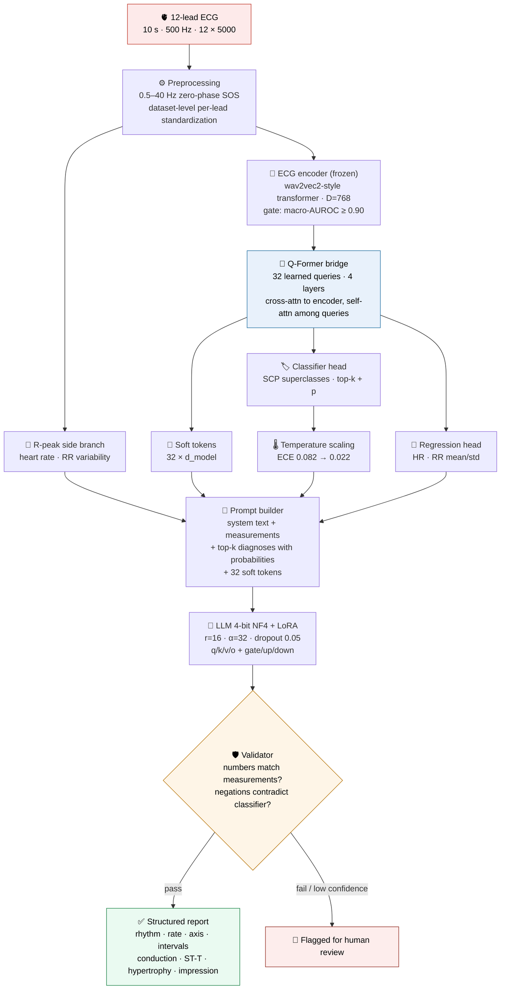
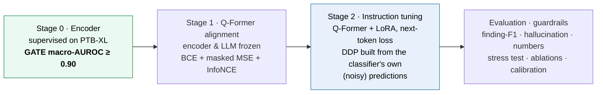
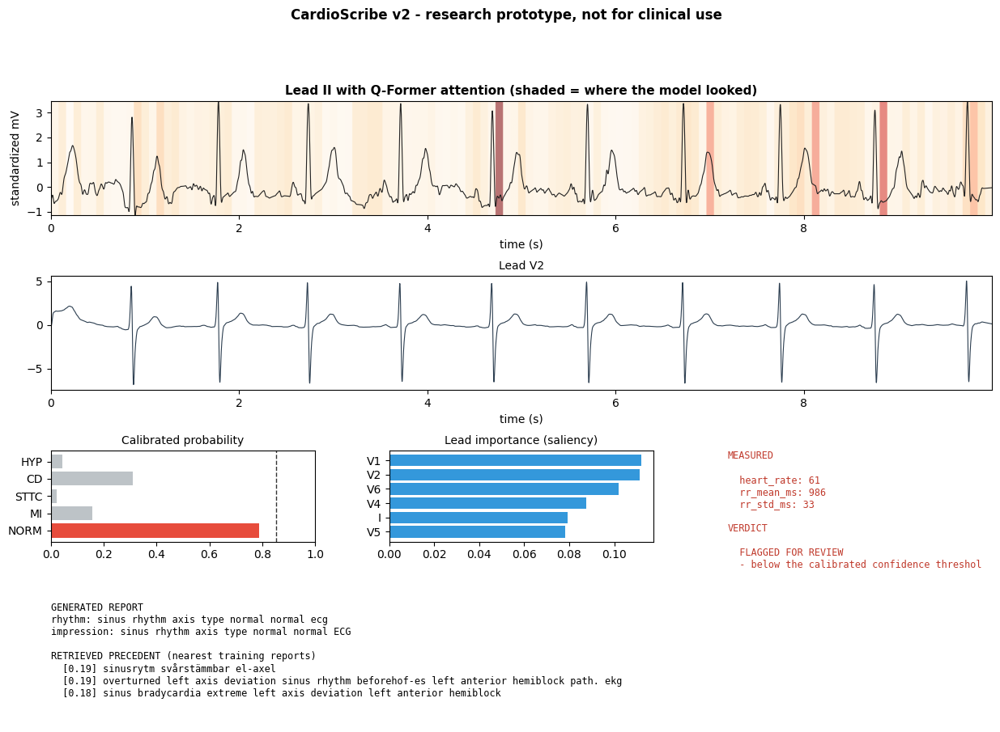
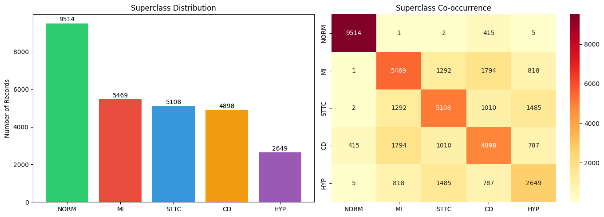
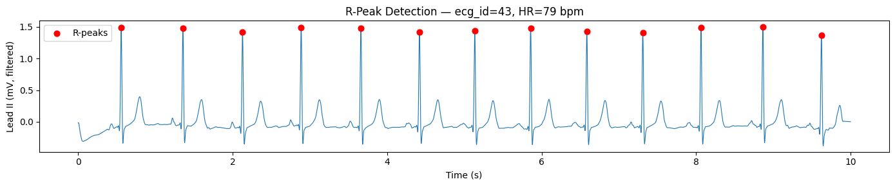
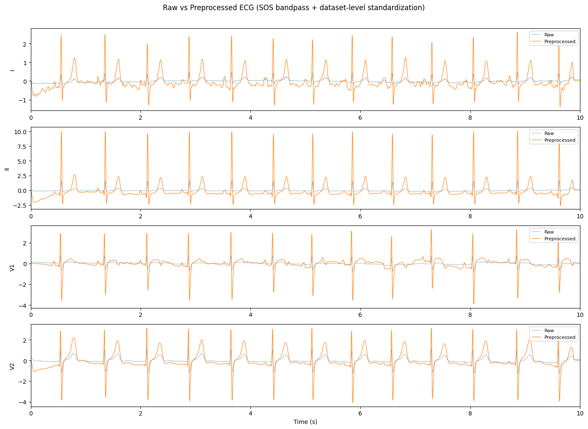
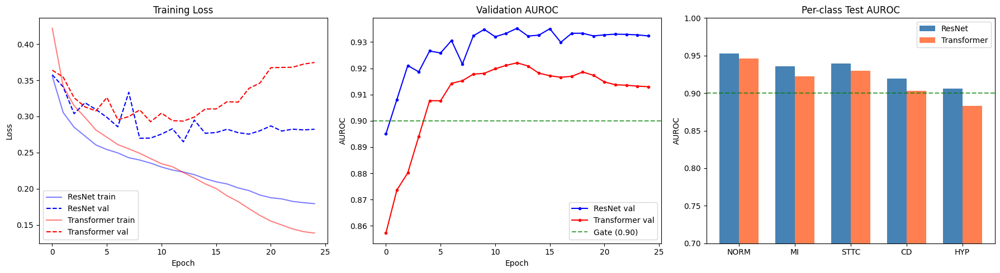
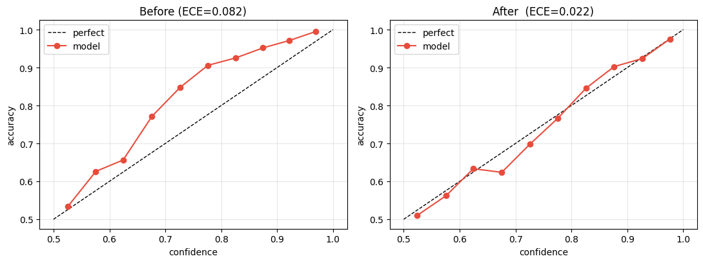
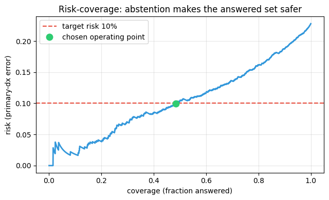

<div align="center">

# 🫀 CardioScribe v2

### From a 10-second 12-lead ECG to a structured, auditable clinical report

*A research prototype that reads the raw signal — not a picture of it — and writes a report a cardiologist can check, line by line, against the evidence.*

[](https://www.python.org/)
[](https://pytorch.org/)
[](https://huggingface.co/docs/transformers)
[](https://physionet.org/content/ptb-xl/1.0.3/)
[](#-results)
[](#-honest-status--what-is-not-done)
[](LICENSE)

> ⚠️ **Not a medical device.** Clinician-in-the-loop decision support only. Every output is drafted for a qualified human to accept, edit or reject. No regulatory clearance has been sought or obtained.

</div>

---

## 📑 Table of contents

| | | |
|---|---|---|
| [⚡ TL;DR](#-tldr) | [🧠 Architecture](#-architecture) | [🖼️ Gallery](#️-gallery) |
| [📊 Results](#-results) | [🔬 Ablations](#-ablations--what-the-evidence-says) | [🧭 Honest status](#-honest-status--what-is-not-done) |
| [🚀 Quickstart](#-quickstart) | [🗂️ Repository map](#️-repository-map) | [📚 Documentation](#-documentation) |

---

## ⚡ TL;DR

CardioScribe v2 is a **signal-language model**: a frozen ECG encoder, a **Q-Former bridge** of 32 learned queries, and a 4-bit quantized LLM with LoRA adapters that turns the bridge's soft tokens — plus *measured numbers* and *calibrated top-k diagnoses* — into a structured report, which a **validator** then checks before anything is returned.

```
12-lead ECG ─► 0.5–40 Hz SOS band-pass ─► frozen encoder ─► Q-Former (32 queries)
       │                                                          │
       └─► R-peaks ─► HR / RR  ────────────┐        ┌─────────────┴──────────────┐
                                           ▼        ▼              ▼             ▼
                          prompt = numbers + top-k dx + 32 soft tokens ──► LLM + LoRA
                                                                              │
                                                       validator ◄────────────┘
                                                           │
                                 structured report  ◄──────┴──────►  flagged for review
```

**Three disciplines, one pipeline** — as the proposal framed it:

| Layer | Role here |
|:--|:--|
| 🧮 **ML** | WFDB I/O, zero-phase SOS band-pass, dataset-level standardization, R-peak measurement, quality control, wavelet ablation |
| 🧠 **DL** | 1D-ResNet baseline, wav2vec2-style transformer encoder, Q-Former cross-attention bridge, multi-task heads, InfoNCE alignment |
| 💬 **GenAI** | 4-bit NF4 LLM + LoRA instruction tuning on soft tokens, Diagnosis-Driven Prompting, output validator, calibrated abstention |

---

## 🧠 Architecture



### Training — three stages, one hard gate



### Design decisions — the three documents, reconciled

Every row below was a disagreement between the **Proposal (Doc 1)** and the **Architecture Analysis (Doc 2)**. The **Blueprint** resolved each one, and the loser of each argument survives in the repo as an *ablation arm* rather than an assertion.

| Decision | Doc 1 (Proposal) | Doc 2 (Analysis) | **Built** | Why |
|:--|:--|:--|:--|:--|
| Sampling | 100 Hz | — | **500 Hz** | Doc 1's own `[12, 5000]` shape only exists at 500 Hz |
| Filter | 0.5–50 Hz `butter` | 0.5–40 Hz + Symlet-8 | **0.5–40 Hz, `sosfiltfilt`** | 50 Hz at 100 Hz sampling sits at Nyquist and SciPy rejects it; SOS is numerically stable and zero-phase |
| Segmentation | full 10 s | 250-sample beat windows | **full 10 s** | AF, flutter, AV block and ectopy need the whole strip; R-peaks serve numbers only |
| Normalization | none | per-record z-score | **dataset-level per-lead** | per-record z-scoring destroys the absolute mV that ST-elevation and LVH criteria depend on |
| Encoder | 1D-ResNet → one 512-d vector | Wav2Vec2 → `[T × D]` | **Transformer D=768**, ResNet kept as baseline arm | a bridge needs a *sequence*, not a global vector |
| Bridge | 2-layer MLP | Q-Former | **Q-Former**, MLP ablated | blueprint's choice — *and the ablation disagrees, see below* |
| Hallucination | not addressed | DDP "corroborate this finding" | **DDP with probabilities + validator**, trained on *noisy* labels | "corroborate this" + a wrong label = a confident wrong report |
| Evaluation | unspecified | clinical > BLEU | **finding-F1, hallucination, numbers, stress test** | BLEU cannot tell *"shows MI"* from *"shows no MI"* |

---

## 🖼️ Gallery

All figures are extracted from the executed notebook and live in [`outputs/figures/`](outputs/figures/) — see the [figure index](outputs/figures/README.md) for captions.

### The report card a clinician actually reads
<p align="center"></p>

*One figure: the strip the model read, where the Q-Former looked, which leads drove the call, calibrated probabilities, measured numbers, the generated narrative, retrieved precedent, and the guardrail verdict.*

<table>
<tr>
<td width="50%"><br/><sub><b>Phase 1 — Data audit.</b> SCP superclass counts and multi-label co-occurrence across 21,837 records.</sub></td>
<td width="50%"><br/><sub><b>Phase 2 — Measurement.</b> R-peaks on lead II; the <i>only</i> job Pan-Tompkins style detection has here (HR and RR), with no beat chopping.</sub></td>
</tr>
<tr>
<td width="50%"><br/><sub><b>Phase 2 — Preprocessing.</b> Raw vs 0.5–40 Hz zero-phase SOS band-pass plus dataset-level standardization.</sub></td>
<td width="50%"><br/><sub><b>Phase 4 — Encoder arms.</b> ResNet1D (Doc 1) vs the transformer encoder (Doc 2), with the 0.90 gate drawn in.</sub></td>
</tr>
<tr>
<td width="50%"><br/><sub><b>Phase 9 — Calibration.</b> Per-class temperature scaling fitted on the validation fold: ECE 0.082 → 0.022.</sub></td>
<td width="50%"><br/><sub><b>Phase 9 — Selective prediction.</b> Risk vs coverage; the abstention threshold (0.852) is <i>chosen from data</i>, not guessed.</sub></td>
</tr>
</table>

---

## 📊 Results

Everything below is **PTB-XL fold 10** (the human-validated test fold), patient-level split, never seen in training. The canonical numbers live in [`results/results_summary.json`](results/results_summary.json).

### Blueprint targets

| Target (Blueprint §1) | Result | Verdict |
|:--|:--|:--:|
| Encoder macro-AUROC ≥ 0.90 | **0.9307** (ResNet1D) · 0.9169 (Transformer) | ✅ **PASS** |
| Hallucination rate < 0.05 | **0.360** | ❌ FAIL |
| Stated numbers agree ≥ 95 % | **n/a** — HR stated in 0/100 reports | ❌ FAIL |
| Finding-F1 beats the ResNet+MLP baseline | micro-F1 **0.643** (bridge ablation favours MLP) | ⚠️ not met |

> 🔎 **Read these as a smoke-test result, not a trained-model result.** Stage 2 ran **10 optimizer steps** (`SMOKE_TEST=True`), not the blueprint's 2–3 epochs. Every Phase 7/8/10 generation number below therefore comes from an essentially untrained LLM. The pipeline, the metrics and the guardrails are real and reproducible; the generation quality is not yet.

> ⚠️ **v2.1 has been written but not run.** The table above is still the only measured
> result. See [What v2.1 changed](#-v21--closing-the-targets) below and
> [docs/RUN_PLAN.md](docs/RUN_PLAN.md).

### Encoder & bridge (Stage 0 / Stage 1)

| Stage | Metric | Value |
|:--|:--|--:|
| Stage 0 — ResNet1D | fold-10 macro-AUROC | **0.9307** |
| Stage 0 — ECGTransformer (deployed) | fold-10 macro-AUROC | 0.9169 |
| Stage 1 — Q-Former classifier | fold-10 macro-AUROC | 0.8920 |
| Stage 1 — ECG→report retrieval | R@1 / R@5 / R@10 | 0.016 / 0.064 / 0.102 |
| Stage 1 — measured numbers | HR MAE / RR-mean MAE / RR-std MAE | 9.12 bpm / 93.1 ms / 48.6 ms |

Per-class AUROC (Stage 1): NORM 0.946 · MI 0.923 · STTC 0.929 · CD 0.904 · HYP 0.888

### Report generation (n = 100, fold 10)

| Metric | Value | Target |
|:--|--:|:--|
| Finding-level micro P / R / F1 | 0.640 / 0.646 / **0.643** | beat baseline |
| Finding-level macro F1 | 0.210 | — |
| Hallucination rate (unsupported findings) | 0.360 | < 0.05 |
| Wrong-label corroboration (stress test) | 0.800 | low is good |
| Flagged for human review | 10 / 100 | — |
| BLEU-4 / ROUGE-L *(secondary)* | 0.070 / 0.298 | — |

Strongest findings by support: `sinus_rhythm` F1 0.87 (n=71) · `normal_ecg` F1 0.74 (n=41) · `sinus_tachycardia` F1 0.67 (n=4) · `myocardial_infarction` F1 0.43 (n=12).

### Calibration, abstention, robustness

| | |
|:--|:--|
| **ECE** (fold 10) | 0.0818 → **0.0221** after per-class temperature scaling |
| **Abstention threshold** | **0.852** (data-driven) vs 0.35 (guessed) |
| **Operating point** | 48.4 % coverage at 10 % realised risk; full coverage risk 22.8 % |
| **Most damaging perturbation** | gain mismatch ×2.0 (−0.036 AUROC) and 3 leads off (−0.036) |
| **Least damaging** | 50 Hz mains ≤ 0.2 mV (−0.002) — the band-pass removes it, as designed |

---

## 🔬 Ablations — what the evidence says

Each ablation settles one disagreement between the source documents rather than asserting a winner.

### 1️⃣ Bridge: Q-Former vs MLP — **the blueprint's choice loses**

| Bridge | macro-AUROC | R@1 | R@5 | HR MAE |
|:--|--:|--:|--:|--:|
| **MLP (Doc 1)** | **0.9171** | **0.014** | **0.050** | **10.13** |
| Q-Former (Doc 2 / blueprint) | 0.8920 | 0.002 | 0.016 | 13.96 |

> 📌 **Leading with the uncomfortable result.** On the same frozen encoder, same losses and same budget, Doc 1's two-layer MLP beats the blueprint's Q-Former on every alignment metric. The Q-Former has ~10× the parameters of the MLP arm and was trained for the same 10 epochs, so the honest reading is *under-trained, not refuted* — but on this budget, the simpler bridge wins and the repo says so.

### 2️⃣ Diagnosis-Driven Prompt: does grounding help, or does it backfire?

| Arm | Finding F1 | Hallucination | Flagged | Corroborates a wrong label |
|:--|--:|--:|--:|--:|
| no DDP | 0.594 | 0.388 | 0.35 | — |
| **noisy DDP** *(deployed)* | 0.610 | 0.367 | 0.12 | — |
| clean DDP *(optimistic ceiling)* | 0.618 | 0.362 | 0.15 | — |
| ⚠️ **wrong DDP** | 0.435 | 0.539 | 0.65 | **0.775** |

> The small clean-vs-noisy gap (0.618 vs 0.610) says the model is *not* leaning entirely on the classifier. The wrong-DDP row is the warning Doc 2 earned: a confidently wrong label is corroborated **~78 %** of the time. The validator catches 65 % of those as flagged — which is exactly why the validator exists, and exactly why a human stays in the loop.

### 3️⃣ Encoder: ResNet (Doc 1) vs Transformer (Doc 2)

| Encoder | fold-10 macro-AUROC |
|:--|--:|
| **ResNet1D** | **0.9307** |
| ECGTransformer (wav2vec2-style, D=768) | 0.9169 |

### 4️⃣ Preprocessing: 0.5–40 Hz vs wider band, ± Symlet-8 — **not run**

The harness is implemented (§33) behind `RUN_PREPROCESSING_ABLATIONS`, because a fair comparison means **retraining the encoder per variant**. It is the one blueprint ablation this run leaves unsettled, and it is off by default rather than faked. Enable with `CARDIOSCRIBE_PREPROC_ABLATION=1`.

---

## 🧭 Honest status — what is *not* done

A model card that only lists strengths is marketing. This one lists the gaps, scoped deliberately and disclosed up front.

| Gap | Status | What it would take |
|:--|:--|:--|
| 🔴 **Stage-2 is a 10-step smoke test** | `SMOKE_TEST=True` | Set `CARDIOSCRIBE_SMOKE=0`, ~2–3 epochs on a 24 GB GPU. **The single highest-value fix.** §19h was rewritten in v2.1 to make a real run fit the sessions you get — see [docs/RUN_PLAN.md](docs/RUN_PLAN.md) |
| 🟠 **Hallucination 0.360 vs < 0.05 target** | failing | Partly downstream of the above; also a metric that scored only half its own definition — rewritten in §43. Strict < 0.05 against PTB-XL's terse references is likely unreachable without the clinician gold set |
| 🟠 **HR never stated in text** (0/100) | number check never fires | **Not** downstream of the smoke test: the gold `rate` field held no numbers, so no training example ever showed the model one. Fixed in §9a |
| 🟡 **Preprocessing ablation unrun** | flag off | GPU-hours, §33 |
| 🟡 **MIMIC-IV-ECG (~800k) not wired in** | PTB-XL only | PhysioNet credentialing + CITI + signed DUA |
| 🟡 **Encoder pretraining is supervised** | not self-supervised | Needs MIMIC above (blueprint step 15) |
| ✅ ~~**PR / QRS / QTc / axis absent**~~ | **measured in §46 (v2.2)** | Was wrongly believed to need PTB-XL+; derivable from the waveform. Verified on synthetic beats, not yet run on real records |
| 🟠 **Lead-II-only R-peak detection** | used by §5 / §12 | Fails under axis deviation and corrupts every derived number. §46 ships the multi-lead fix; `measured_numbers.npz` predates it |
| 🟡 **No external validation** | harness **completed** in §49, still unrun | Needs the dataset + the trained encoder + a GPU. §49 reads the set's own SNOMED table rather than a hand-copied one — a fabricated external number would be worse than none |
| 🟡 **No clinician gold set** | protocol + adjudication + κ + scoring built in §50 | 2 cardiologists + adjudicator over 500–1,000 ECGs. The one step code cannot take |
| ⚪ **Five superclasses only** | NORM / MI / STTC / CD / HYP | The full 71 SCP statements are out of scope for v2 |
| ⚪ **Fairness unmeasured** | no subgroup analysis | Age/sex stratified evaluation |

Reference text is PTB-XL's own report — ~63 % German, machine-translated here — so finding-level F1 measures **agreement with a noisy reference**, not agreement with ground truth.

---

## 🔧 v2.1 — closing the targets

> **Status: written, not run.** Nothing in this section has produced a number yet.
> The run is ~3–4 h on one T4; the schedule is in [docs/RUN_PLAN.md](docs/RUN_PLAN.md).

v2.0 attributed all three failed targets to one cause — Stage 2 ran as a 10-step smoke
test. That is the largest cause, but re-reading the pipeline turned up two more that a
longer training run would **not** have fixed.

### What was actually wrong

| Failure | The cause nobody had named |
|:--|:--|
| **Numbers: HR in 0/100 reports** | `extract_schema` filled the `rate` field for 7.4 % of records and never with a bpm value — it scraped the *word* "bradycardia" out of report text. No gold target ever contained a number, so the model could not learn to state one at any training budget. |
| **Hallucination 0.360** | Two things. The SCP fallback wrote the literal string `"sttc (from SCP label)"` into the gold prose, and the v2.0 model learned to emit it — visible in the §25 sample. And §26 scores against the reference only, while the blueprint defines hallucination as unsupported by "the reference **or signal**". |
| **Finding-F1 vs baseline** | §28 compared the two bridges on AUROC and retrieval. Neither arm was ever scored on F1 — the metric the target names. |

### What changed

| Area | Change |
|:--|:--|
| **Gold targets** (§9a-pre, §9a) | Heart rate measured once per record from lead-II R-peaks and written into every `rate` field; the SCP fallback now writes clinical phrasing instead of a schema placeholder |
| **Stage 2** (§19b, §19h) | Micro-batch 1 → 4 (one epoch was ~22 h, which is *why* it fell back to a smoke test); val-loss checkpointing, best-checkpoint selection, a wall-clock budget and resume across sessions |
| **Evidence gate** (§42, §42b) | Per-class temperature and thresholds fitted **on fold 9 only**; the validator now repairs as well as flags — strikes clauses the signal will not support, writes in the measured rate, hedges below threshold. Every edit is recorded, so the delta between the model's text and the shipped text is never silent |
| **Metrics** (§43) | Both hallucination definitions reported side by side, with tp / fp / fn counts |
| **Head-to-head** (§44) | The missing arm: Doc 1's MLP bridge with a soft-token head, so both bridges can drive the same LLM and be scored on F1 |
| **Target table** (§45) | Re-scores every target and rewrites `results_summary.json` — from measured numbers only; if Stage 2 is still a smoke test, it says so and the targets stay failed |

### Three things the re-run will *not* paper over

**The gate never reads the reference.** It sees the calibrated classifier and the
deterministic measurements, nothing else. If it could see the reference, the strict
hallucination metric would be measuring the gate against itself.

**Number agreement is reported twice.** *After validator* will be ~1.00 — the validator
writes the measured value in, which is near-tautological and labelled as such. *Model
unaided* is the number that says whether the model learned anything. Read that column.

**Strict hallucination < 0.05 probably will not pass.** Strict precision is capped by
how much PTB-XL's one-clause, machine-translated references omit: a finding the signal
fully supports still counts against us if the reference simply did not mention it. The
blueprint's own "reference **or** signal" number is reported too, but it is driven by
the same signal that drives the gate, so it is *not* independent evidence — §43 says
so where it prints it. The clean route to this target is the clinician gold set.

And a caveat on reading the gate's effect: striking a correct-but-ungrounded claim
removes a true positive as well as a false one, so the strict *ratio* can rise while
the false-positive *count* falls. §43 prints the counts for exactly that reason.

---

## 🧪 v2.2 — the honest next steps, as far as software goes

§40's report card listed four next steps. **Three cannot be completed in code**, and
this section says which rather than shipping a stub and calling it done.

| Step | Blocked on | Delivered |
|:--|:--|:--|
| 1. MIMIC-IV-ECG → SSL pretraining | **Your** CITI certificate and signed DUA; ~800k records; GPU-weeks | §51: objective + loader, ready. **No result.** |
| 2. PR/QRS/QTc/axis + complete number validator | *Nothing* | §46–48: **done and verified** |
| 3. External validation (Chapman/CPSC) | Dataset download, the trained encoder, a GPU | §49: harness completed from stub to working. **No number.** |
| 4. Clinician gold set | **Actual cardiologists** | §50: protocol, adjudication, agreement, scoring. **No readings.** |

### Step 2 is done — and the model card was wrong

The model card said PR, QRS, QT/QTc and axis *"require PTB-XL+"*. **They don't.**
PTB-XL+ is a convenient source of vendor 12SL/Glasgow values; every one of these
quantities is derivable from the waveform. §46 measures them, verified against
synthetic beats whose intervals are exact by construction:

| Quantity | Residual bias | Max abs. error |
|:--|--:|--:|
| PR | −1.4 ± 4.5 ms | 10 ms |
| QRS | −6.8 ± 1.6 ms | 10 ms |
| QT | −10.4 ± 0.8 ms | 12 ms |
| Frontal axis | −0.1 ± 0.6° | 0.9° |

Bias is **reported, not calibrated away** — an offset fitted to synthetic data would
not transfer. §48 measures the same bias against PTB-XL+ vendor values on real records.

### Two real bugs surfaced while verifying it

**Wavelet boundaries over-measure QRS by ~26 ms.** DWT places boundaries where the
modulus maxima cross a threshold, outside the visible wave. At the 120 ms "wide QRS"
threshold that turns a normal 100 ms complex into a **false bundle-branch-block flag**
— which the first test run did emit. §46 takes peaks from DWT and boundaries from a
baseline-threshold walk on a median beat.

**Single-lead R-peak detection fails under axis deviation.** §5 and §12 detect on lead
II alone. At −45° lead II's QRS is small and inverted (p2p 0.36 mV vs 2.06 in V6); the
detector locks onto the wrong deflection and corrupts every downstream interval —
while *each lead measured alone was correct*. §46 detects on the 12-lead vector
magnitude. **The committed `measured_numbers.npz` was computed the old way**, so some
HR values are suspect; `rpeak_source` now records which path was used.

A third was caught by the §47 tests: the QT regex used a lookbehind, which guards the
wrong side and read `QTc 455 ms` as a QT of 455 — fabricating a mismatch against a
number the report never claimed.

### What is still open, and why

Steps 1, 3 and 4 are blocked on a credentialing process, a dataset download plus GPU,
and on two cardiologists reading 500–1,000 ECGs. §50 builds the blank intake sheets,
computes Cohen's κ **before** adjudication (low κ means the readers weren't reading
the same thing — fix the definition, don't average the disagreement away), leaves
unadjudicated disagreements *unresolved* rather than resolving by majority-of-two,
and scores finding-F1 against the adjudicated reading. That last number is what
blueprint target 2 actually asks for; everything else in this repo is agreement with
a translated machine report.

---

## 🚀 Quickstart

### 1. Get the data

PTB-XL is **not** in this repository (1.8 GB; GitHub rejects files over 100 MB). Download it from PhysioNet:

```bash
wget -r -N -c -np https://physionet.org/files/ptb-xl/1.0.3/
# or
wget https://physionet.org/static/published-projects/ptb-xl/ptb-xl-a-large-publicly-available-electrocardiography-dataset-1.0.3.zip
```

Expect **21,837** records at 500 Hz (`records500/`) and the same count in `ptbxl_database.csv`.

### 2. Install

```bash
python -m venv .venv && source .venv/bin/activate     # Python 3.11
pip install torch --index-url https://download.pytorch.org/whl/cu121
pip install -r requirements.txt
```

### 3. Point the notebook at your data

The notebook auto-detects Kaggle, Colab and local layouts. Override explicitly if you like:

```bash
export CARDIOSCRIBE_DATA=/path/to/ptb-xl-1.0.3     # read-only, holds ptbxl_database.csv
export CARDIOSCRIBE_WORK=/path/to/workdir          # writable: caches + checkpoints
jupyter lab CardioScribe_v2.ipynb
```

Then **Run All**, in order — phases depend on each other's caches.

### Reproducing the full run

> 📋 **Start with [docs/RUN_PLAN.md](docs/RUN_PLAN.md).** The v2.1 patch rewrote the
> Stage-2 loop and added sections 42–45 to close the three failed blueprint targets.
> It also found two causes that a longer training run would *not* have fixed: the gold
> targets contained no numbers, and the hallucination metric implemented only half its
> own definition. The run plan has the cell-by-cell schedule, the flags, and a frank
> account of which targets are expected to pass and which are not.

| Variable | Default | Set to | Effect |
|:--|:--|:--|:--|
| `CARDIOSCRIBE_SMOKE` | `1` | `0` | Stage 2 runs the blueprint schedule instead of 10 steps |
| `CARDIOSCRIBE_TEMPLATES` | all 5 | `3` | Fewer instruction templates → fewer pairs per epoch |
| `CARDIOSCRIBE_S2_MAX_STEPS` | none | `700` | Hard step cap that also sets the cosine `T_max`, so the LR anneals over the budget you intend to spend |
| `CARDIOSCRIBE_MICRO_BATCH` | `4` | `1` on OOM | `GRAD_ACCUM` compensates; effective batch stays 32 |
| `CARDIOSCRIBE_TIME_BUDGET_H` | none | e.g. `3` | Checkpoint and stop cleanly before a session timeout |
| `CARDIOSCRIBE_RESUME` | `0` | `1` | Resume Stage 2 from `stage2_state.pt` |
| `CARDIOSCRIBE_PREPROC_ABLATION` | `0` | `1` | Runs the filter-band / Symlet-8 ablation (GPU-hours) |
| `CARDIOSCRIBE_DATA` | auto | path | PTB-XL root |
| `CARDIOSCRIBE_WORK` | auto | path | Writable working directory |

```bash
CARDIOSCRIBE_SMOKE=0 CARDIOSCRIBE_TEMPLATES=3 CARDIOSCRIBE_S2_MAX_STEPS=700 \
  jupyter nbconvert --to notebook --execute CardioScribe_v2.ipynb
```

**Budget:** ~3.5 h for a 700-step Stage 2, ~6–7.5 h for one full epoch, ~23–30 h for
the blueprint's 3 epochs — and the §44 head-to-head needs a *second* pass at the same
budget. Stage 2 is ~1.05 s/sample at micro-batch 1 (measured); micro-batch 4 should
beat that by 2–3×, which §19h prints as it runs.

> The outputs committed in the notebook are from a Kaggle run with `SMOKE_TEST=True` on a single GPU. Phases 1–5 and 9 are full runs; only Stage 2 is budget-capped. **The v2.1 changes have not been run** — `results/results_summary.json` still holds the v2.0 numbers, and section 45 overwrites it once the re-run completes.

### Hardware

| | |
|:--|:--|
| **GPU** | 1 × 24 GB (RTX 3090/4090 or cloud equivalent). An 8B model in 4-bit ≈ 6 GB of weights plus activations; a 16 GB T4 fits with micro-batch 1 + accumulation. |
| **RAM / disk** | 64 GB RAM; ~100 GB for PTB-XL plus the encoder-output caches |
| **Runtime** | Phases 1–5 ≈ several GPU-hours. Stage 2 ≈ 1.05 s per sample. At v2.0's micro-batch 1 that is 2,411 optimizer steps and **~22 h per epoch** — the reason the committed run is a smoke test. v2.1's micro-batch 4 plus `CARDIOSCRIBE_TEMPLATES=3` brings one real epoch to ~2.5–3 h |

> ℹ️ The committed run used **`Qwen/Qwen2.5-1.5B-Instruct`** as the decoder, not Llama-3-8B — it needs no gated-license approval and fits a smaller GPU. `LLM_NAME` is a single constant; any 7–8B instruct model works, and the soft-token head re-fits itself to the loaded model's true hidden size (§19c).

---

## 🗂️ Repository map

```
CardioScribe-v2/
├── CardioScribe_v2.ipynb          # the complete pipeline, Phases 0–10 + Part VI (§42–45), with executed outputs
├── README.md                      # you are here
├── requirements.txt               # pinned-by-floor dependency set
├── LICENSE                        # MIT (code only — data and models carry their own)
├── .gitignore                     # keeps PTB-XL, checkpoints and caches out of git
├── docs/
│   ├── PROJECT_DOCUMENTATION.md   # full technical documentation, phase by phase
│   ├── MODEL_CARD.md              # intended use, limitations, safety, privacy
│   ├── BLUEPRINT_COMPLIANCE.md    # blueprint step → notebook section traceability matrix
│   └── RUN_PLAN.md                # v2.1: what changed, what to re-run, what will and won't pass
├── outputs/
│   └── figures/                   # every figure from the executed notebook
│       ├── README.md              # captioned figure index
│       └── 01…08_*.png
└── results/
    └── results_summary.json       # machine-readable metrics, scored against the targets
```

---

## 📚 Documentation

| Document | What's in it |
|:--|:--|
| 📘 [**Project documentation**](docs/PROJECT_DOCUMENTATION.md) | Every phase: what it does, why, the exact hyperparameters, inputs and artifacts |
| 🏷️ [**Model card**](docs/MODEL_CARD.md) | Intended use, out-of-scope use, limitations, safety mechanisms, privacy |
| ✅ [**Blueprint compliance matrix**](docs/BLUEPRINT_COMPLIANCE.md) | Blueprint step → notebook section → status, all 22 numbered steps |
| 📋 [**Run plan**](docs/RUN_PLAN.md) | What the v2.1 patch changed, what to re-run, and which targets will and will not pass |
| 🖼️ [**Figure index**](outputs/figures/README.md) | Captions and provenance for all 8 figures |

---

## 🧾 Citation & acknowledgements

The data this project stands on:

```bibtex
@article{wagner2020ptbxl,
  title   = {PTB-XL, a large publicly available electrocardiography dataset},
  author  = {Wagner, Patrick and Strodthoff, Nils and Bousseljot, Ralf-Dieter and
             Kreiseler, Dieter and Lunze, Fatima I. and Samek, Wojciech and Schaeffter, Tobias},
  journal = {Scientific Data},
  volume  = {7}, number = {1}, pages = {154}, year = {2020},
  doi     = {10.1038/s41597-020-0495-6}
}
```

PTB-XL is distributed by PhysioNet under CC-BY 4.0. Goldberger et al. (2000), *Circulation* 101(23):e215–e220, for PhysioNet itself.

---

<div align="center">

**CardioScribe v2** · built by [@APARIJIT CHAKRABORTY](https://github.com/aparijit05072004) · research prototype, not for clinical use

*It drafts. A cardiologist decides.*

</div>
