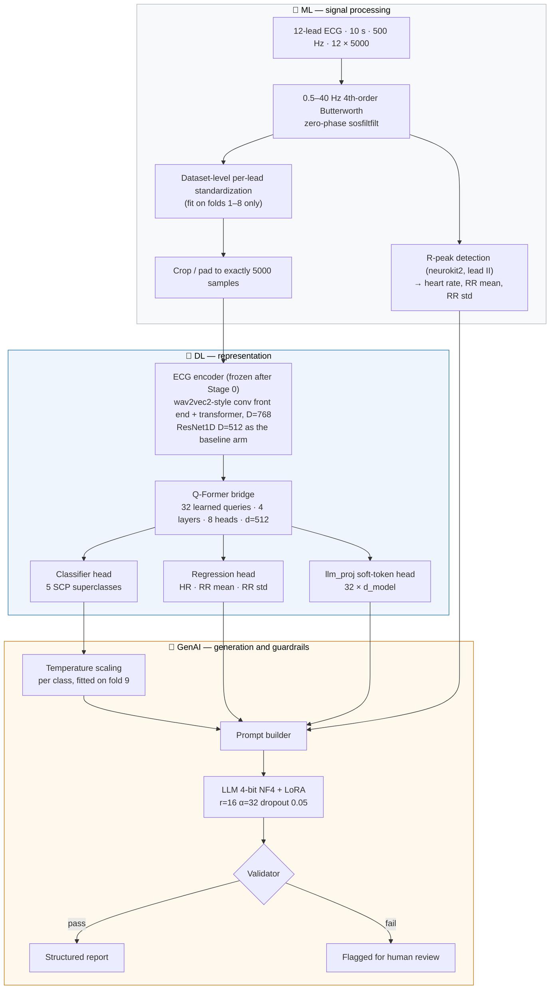

<div align="center">

# 📘 CardioScribe v2 — Project Documentation

**ECG-to-report research prototype · PTB-XL · signal-language model**

*Complete technical reference: every phase, why it exists, what it does, what it produces.*

</div>

---

## Contents

1. [Objective and scope](#1-objective-and-scope)
2. [How the three source documents were reconciled](#2-how-the-three-source-documents-were-reconciled)
3. [System architecture](#3-system-architecture)
4. [Phase 0 — Runtime configuration](#phase-0--runtime-configuration)
5. [Phase 1 — Data audit and splits](#phase-1--data-audit-and-splits)
6. [Phase 2 — Preprocessing and measurement](#phase-2--preprocessing-and-measurement)
7. [Phase 3 — Text curation](#phase-3--text-curation)
8. [Phase 4 — Stage 0: the ECG encoder and the hard gate](#phase-4--stage-0-the-ecg-encoder-and-the-hard-gate)
9. [Phase 5 — Stage 1: Q-Former alignment](#phase-5--stage-1-q-former-alignment)
10. [Phase 6 — Stage 2: instruction tuning with QLoRA](#phase-6--stage-2-instruction-tuning-with-qlora)
11. [Phase 7 — Inference and guardrails](#phase-7--inference-and-guardrails)
12. [Phase 8 — Evaluation](#phase-8--evaluation)
13. [Phase 9 — Robustness, calibration, ablations](#phase-9--robustness-calibration-ablations)
14. [Phase 10 — Grounding, explainability, deployment](#phase-10--grounding-explainability-deployment)
15. [Part VI — Target closure (§42–45, v2.1)](#part-vi--target-closure-4245-v21)
16. [Part VII — The honest next steps (§46–51, v2.2)](#part-vii--the-honest-next-steps-4651-v22)
17. [Artifacts produced](#15-artifacts-produced)
18. [Reproduction](#16-reproduction)
19. [Known limitations and next steps](#17-known-limitations-and-next-steps)
20. [Glossary](#18-glossary)

---

## 1. Objective and scope

> **Build a research prototype that reads a 10-second 12-lead ECG and writes a structured English clinical report, grounded in measurable signal evidence, runnable on one 24 GB GPU.**

The report covers **rhythm, rate, axis, intervals, conduction, ischemia and ST-T changes, hypertrophy, and an overall impression**.

It is **clinician-in-the-loop decision support**, not an autonomous diagnostic tool.

### Measurable targets (Blueprint §1) and where they landed

| # | Target | Result | Status |
|:--|:--|:--|:--:|
| 1 | Encoder macro-AUROC ≥ 0.90 on the PTB-XL superclass test fold — *a gate: stop and fix before moving on* | 0.9307 (ResNet1D), 0.9169 (Transformer) | ✅ |
| 2 | Clinical-finding F1 on a held-out gold set beats the ResNet+MLP baseline | micro-F1 0.643; the bridge ablation currently favours the MLP arm | ⚠️ |
| 3 | Hallucination rate below 5 % | 0.360 | ❌ |
| 4 | Numbers in the text (HR, PR, QRS, QTc) agree with measurements ≥ 95 % of the time | HR stated in 0/100 reports, so the check never fires | ❌ |

**Non-goals, stated up front:** regulatory clearance, autonomous diagnosis, 2D ECG-image input.

### Why targets 2–4 are not met

Stage 2 (instruction tuning) ran as a **10-optimizer-step smoke test**, not the blueprint's 2–3 epochs. The LLM is therefore essentially untrained, and every generation-side number is a floor, not a result. The pipeline, the metrics, the guardrails and the ablation harnesses are complete and reproducible; the generation quality is not. Setting `CARDIOSCRIBE_SMOKE=0` runs the real schedule.

**That is the largest cause, but not the only one.** Re-reading the pipeline for the v2.1 pass found two failures with causes a longer training run would not have touched, and one metric comparison that was never made:

| Target | The additional cause | Addressed in |
|:--|:--|:--|
| 4 — numbers | `extract_schema` populated the `rate` field for 7.4 % of records and never with a bpm value; it matched the *word* "bradycardia" in report text. No gold target contained a number, so the model could not learn to state one at **any** training budget. | Phase 3, §9a-pre and §9a |
| 3 — hallucination | The SCP-label fallback wrote the literal string `"sttc (from SCP label)"` into the gold prose, and the v2.0 model learned to emit it. Separately, §26 scores against the reference text only, while the blueprint defines hallucination as unsupported by "the reference **or signal**". | §9a; Part VI §42–43 |
| 2 — finding-F1 | §28 compared the two bridges on AUROC and retrieval. Neither arm was ever scored on F1, the metric the target names. | Part VI §44 |

See [RUN_PLAN.md](RUN_PLAN.md). **None of the v2.1 work has been run**, so the table above still holds the only measured results.

---

## 2. How the three source documents were reconciled

Three documents fed this build:

| Doc | Title | Role |
|:--|:--|:--|
| **Doc 1** | *CardioScribe Project Proposal* | The original architecture: 1D-ResNet → MLP bridge → Llama-3-8B + QLoRA |
| **Doc 2** | *ECG Architecture Analysis and Update* | A revision: wavelet denoising, beat windows, Wav2Vec2, Q-Former, Diagnosis-Driven Prompting |
| **Blueprint** | *CardioScribe v2: ECG-to-Report Project Blueprint* | The reconciliation — takes the best of each, turns the disagreements into ablations, adds a real evaluation plan |

### Flaws in the source documents, and how each was handled

**In Doc 1:**

| Flaw | Fix in this build |
|:--|:--|
| Shape error — 100 Hz × 10 s is `[12, 1000]`, not `[12, 5000]` | Native **500 Hz** throughout, which makes `[12, 5000]` correct |
| Invalid filter — 0.5–50 Hz at 100 Hz sampling puts the upper edge at Nyquist; SciPy's `butter` rejects it | **0.5–40 Hz at 500 Hz**, well inside Nyquist, in **SOS form** with `sosfiltfilt` |
| Bridge mismatch — the MLP docstring expects `[B, T, 512]` but the ResNet emits one global vector with no sequence dimension | Encoders expose `return_embeddings=True` and emit a **sequence** `[B, T′, D]` the bridge can cross-attend to |
| Naming — "Vision-Language Model" for a model that never sees an image | Described throughout as a **signal-language model** |

**In Doc 2:**

| Flaw | Fix in this build |
|:--|:--|
| Beat chopping (250-sample windows) contradicts its own goal — 250 samples is 0.5 s at 500 Hz, yet AF, flutter, AV block and ectopy need the whole strip | **No beat chopping.** The full 10 s reaches the encoder; R-peaks serve HR and RR only. Beat windowing is not deployed. |
| Per-record per-lead z-scoring removes absolute voltage, which ST-elevation (mm) and LVH voltage criteria depend on | **Dataset-level per-lead standardization**, fitted on the training folds only, which preserves relative mV scale |
| No ECG pretraining — Wav2Vec2 trained on speech does not transfer to ECG, and the encoder is frozen in both stages | Encoder is **trained on ECG** (supervised on PTB-XL) before being frozen. Self-supervised pretraining on MIMIC-IV-ECG is documented as the open step. |
| "Ground-truth text" is overstated — MIMIC reports are largely machine-generated and PTB-XL reports are short and mostly German | Disclosed explicitly: translation noise is a named limitation, and finding-F1 is framed as *agreement with a noisy reference* |
| DDP can backfire — a wrong classifier label plus "corroborate this finding" yields a confident wrong report | DDP carries **probabilities**, is trained on the classifier's **own noisy predictions**, is followed by a **validator**, and is explicitly stress-tested (§27, §34) |
| Overstated or premature claims (Wav2Vec2 "consistently beats" ResNet, LoRA at ~4 % of parameters, multi-token prediction, a 40 Hz low-pass) | Each became an **ablation or an exclusion**, not an assumption. Multi-token prediction is skipped — it needs a model trained for it. |

Both documents lacked a real evaluation plan and said nothing about privacy or data-use terms. Both are addressed in [Phase 8](#phase-8--evaluation) and the [model card](MODEL_CARD.md).

---

## 3. System architecture



### Component specification

| Component | Specification |
|:--|:--|
| **Input** | Native 1D, 12 leads, 10 s at 500 Hz → `[12, 5000]`, units mV |
| **Filter** | 4th-order Butterworth band-pass 0.5–40 Hz, second-order-sections form, zero-phase (`sosfiltfilt`) |
| **Normalization** | Dataset-level per-lead mean/std, computed on train folds only; preserves relative mV scale |
| **ECG encoder** | wav2vec2-style: 12-channel conv front end + 6-layer transformer, D=768, output `[B, T′, 768]`. ResNet1D (8 residual blocks, D=512) kept as the Doc-1 baseline arm |
| **Bridge** | Q-Former — 32 learned queries, 4 layers, 8 heads, d=512, FF 2048; self-attention among queries, cross-attention to the encoder sequence; output `[B, 32, 512]` |
| **Heads** | Multi-label SCP superclass classifier; measured-number regressor (HR, RR mean, RR std); `llm_proj` soft-token projection to the LLM's hidden size |
| **LLM** | 4-bit NF4 via bitsandbytes. This run: `Qwen/Qwen2.5-1.5B-Instruct`. Any 7–8B instruct model (Llama-3/3.1, Qwen-class) drops in via `LLM_NAME` |
| **LoRA** | r=16, α=32, dropout 0.05, on `q/k/v/o` and `gate/up/down` projections |
| **Prompt** | System text + measured values + top-k diagnoses with calibrated probabilities + 32 soft tokens |
| **Validator** | Numbers in text vs measurements (±10 bpm tolerance); negation/assertion contradictions vs the classifier; confidence vs the calibrated threshold |

---

## Phase 0 — Runtime configuration

**Notebook:** section 0 · **Blueprint:** step 0 (access and setup)

Locates PTB-XL, builds a writable working directory, and sets the two run-mode flags. Nothing is hard-coded to one machine.

| Environment variable | Default | Purpose |
|:--|:--|:--|
| `CARDIOSCRIBE_DATA` | auto-detect (`/kaggle/input`, `/content/ptb-xl`, `./ptb-xl-data`, `.`) | Read-only PTB-XL root containing `ptbxl_database.csv` |
| `CARDIOSCRIBE_WORK` | `/kaggle/working/ptb-xl-data` on Kaggle, else `./ptb-xl-data` | Writable directory for caches and checkpoints |
| `CARDIOSCRIBE_SMOKE` | `1` | `0` runs the full Stage-2 schedule (3 epochs, no step cap) |
| `CARDIOSCRIBE_PREPROC_ABLATION` | `0` | `1` runs the filter-band / Symlet-8 ablation (GPU-hours) |

The cell asserts on a missing dataset with a message pointing at <https://physionet.org/content/ptb-xl/1.0.3/>, and verifies **21,837** metadata rows against **21,837** `records500/*.dat` files.

> **Access steps the blueprint lists but this run did not need:** a PhysioNet credentialed account (CITI training plus a signed data use agreement) for MIMIC-IV-ECG, and Hugging Face Llama licence acceptance. PTB-XL is open-access, and the committed run used an ungated Qwen model.

---

## Phase 1 — Data audit and splits

**Notebook:** sections 1–3 · **Blueprint:** steps 3–4

### What it does

1. Loads `ptbxl_database.csv` (21,837 records) and `scp_statements.csv`.
2. Verifies signal properties on sampled records: **12 leads**, standard order `I, II, III, aVR, aVL, aVF, V1–V6`, units **mV**, shape `[5000, 12]` at 500 Hz.
3. Quality control: scans for **NaN**, **flat** (zero-variance) and **clipped** leads (|x| ≥ 4.0 mV, typical ADC saturation).
4. Maps each record's SCP codes to the **five diagnostic superclasses** — `NORM`, `MI`, `STTC`, `CD`, `HYP` — using `scp_statements.csv`'s `diagnostic_class` column. The task is **multi-label**: a record may carry several superclasses.
5. Builds **patient-level splits** from PTB-XL's own `strat_fold`, which guarantees no patient appears in two splits.

| Split | Folds | Purpose |
|:--|:--|:--|
| Train | 1–8 | All model fitting, and the standardization statistics |
| Validation | 9 | Early stopping, temperature scaling, threshold selection |
| Test | 10 | Every reported number. Human-validated fold. |

**Figure:** [`01_superclass_distribution.png`](../outputs/figures/01_superclass_distribution.png) — counts plus the co-occurrence heatmap.

---

## Phase 2 — Preprocessing and measurement

**Notebook:** sections 4–6 · **Blueprint:** steps 5–9

### 2a. One deterministic preprocessing function

```python
def preprocess_ecg(rec_path, lead_mean=LEAD_MEAN, lead_std=LEAD_STD):
    signals, _ = wfdb.rdsamp(rec_path)      # [5000, 12] at native 500 Hz, mV
    signals = apply_bandpass(signals)       # 0.5–40 Hz, 4th order, SOS, zero-phase
    signals = pad_or_crop(signals)          # exactly 5000 samples
    return (signals - lead_mean) / lead_std # dataset-level per-lead, train-fitted
```

| Step | Choice | Rationale |
|:--|:--|:--|
| Load | `wfdb` at **native 500 Hz** | No resampling means no resampling artifacts. If downsampling is ever needed, use anti-aliased `resample_poly` *before* anything else. |
| Filter | 4th-order Butterworth **0.5–40 Hz**, `sosfiltfilt` | SOS form is numerically stable at 4th order; `filtfilt` is zero-phase, so QRS timing is not shifted. Cutoffs are constants, so the band is ablatable. |
| Length | Crop or pad to exactly **5000** | Fixed tensor shape for batching |
| Normalize | **Dataset-level per-lead** mean/std, **fitted on folds 1–8 only** | Keeps relative mV scale, which ST-elevation and LVH voltage criteria need. Computed in a streaming pass (running sum and sum of squares) over the training folds only — no test leakage. |

**Figure:** [`02_preprocessing_raw_vs_filtered.png`](../outputs/figures/02_preprocessing_raw_vs_filtered.png)

### 2b. R-peaks — the side branch

`neurokit2.ecg_peaks` on **lead II** (the standard rhythm lead) yields:

* `heart_rate` — from the median RR interval
* `rr_mean_ms`, `rr_std_ms` — RR variability

> **This is the only role beat detection has.** No beat windows are cut. The full 10 s strip reaches the encoder, because the arrhythmias that matter most — AF, atrial flutter, AV block, ectopy — are visible only across the whole strip.

These three numbers become the regression targets in Stage 1 and the **measured values the validator checks the generated text against** in Phase 7.

**Figure:** [`03_rpeak_detection_lead_ii.png`](../outputs/figures/03_rpeak_detection_lead_ii.png)

### 2c. Dataset and loader

`CardioScribeDataset` wraps the above into a `torch.utils.data.Dataset` returning `(signal[12, 5000], label[5], measured[3])`.

---

## Phase 3 — Text curation

**Notebook:** sections 7–9 · **Blueprint:** steps 10–13

PTB-XL reports are roughly **63 % German, 30 % English, 7 % Swedish or mixed**. They are short machine or clinician reports, not narrative prose.

| Step | Implementation |
|:--|:--|
| **Language detection** | Marker-word classification (German / English / Swedish token sets) |
| **Boilerplate cleaning** | Strips `unbestätigter bericht` ("unconfirmed report"), software version strings, normalizes whitespace |
| **Translation — tier 1** | A hand-built **ECG domain dictionary** of ~120 German→English terms, applied longest-match-first so `linksschenkelblock` is not mangled by a shorter key |
| **Translation — tier 2** | **MarianMT** (`Helsinki-NLP/opus-mt-de-en`) for residual German, batched (64) for throughput. **Local inference only** — no report text leaves the machine, which is mandatory if MIMIC-IV-ECG is ever added, as its DUA forbids sending data to external APIs |
| **Schema extraction** | Each report is mapped to eight fixed fields: `rhythm, rate, axis, intervals, conduction, st_t, hypertrophy, impression`, by keyword matching with SCP-code mapping as backup |
| **Measured rate** *(v2.1)* | §9a-pre measures heart rate once per record from lead-II R-peaks and caches it to `hr_by_ecg_id.npz`; §9a writes it into the `rate` field of every gold report |
| **Instruction pairs** | 3–5 templates per record (full report, impression only, rhythm only, ST-T only, "is X present?") → `instruction_pairs.jsonl` |

> ⚠️ **Translation noise is a real limitation.** The text targets are machine-translated from short German reports, so the training signal — and the reference text every finding-level metric is scored against — carries that noise. This is disclosed in the [model card](MODEL_CARD.md).

> 🔧 **Two defects found in v2.0's schema extraction, both fixed in v2.1 and both requiring Phase 3 to be re-run.**
>
> **The `rate` field held no numbers.** Keyword matching filled it for 7.4 % of records, and when it did it captured words — "bradycardia", "tachycardia" — never a bpm value. Blueprint target 4 asks that numbers in the generated text agree with deterministic measurements; with no number in any gold target, the model never learned to state one, heart rate appeared in 0/100 generated reports, and the check never fired. The target was unreachable at any training budget. §9a now writes the measured value, so `rate` coverage goes from 7.4 % to ~100 % and every gold report carries the number the validator later checks against.
>
> **A schema placeholder leaked into clinical prose.** When a superclass label had no matching text, the fallback wrote the literal string `f'{sc.lower()} (from SCP label)'` into the gold report — so `"sttc (from SCP label)"` became a training target. The v2.0 model learned to emit it verbatim; it is visible in the §25 sample output. The fallback now writes ordinary clinical phrasing (`"ST-segment and T-wave abnormality"`).

**Artifacts:** `ptbxl_curated.csv`, `instruction_pairs.jsonl`

---

## Phase 4 — Stage 0: the ECG encoder and the hard gate

**Notebook:** sections 10a–10h · **Blueprint:** steps 14–16

Two encoders are trained so the Doc-1 / Doc-2 argument can be settled with numbers.

| Arm | Architecture | Output |
|:--|:--|:--|
| **ResNet1D** (Doc 1) | 8 residual blocks, 1D convolutions, D=512 | `[B, T′, 512]` with `return_embeddings=True` |
| **ECGTransformer** (Doc 2) | wav2vec2-style conv feature extractor + 6-layer transformer, D=768, 8 heads | `[B, T′, 768]` |

**Training:** multi-label BCE, AdamW with cosine LR, mixed precision, gradient clipping, batch 64, 25 epochs, LR 1e-3, weight decay 1e-4; best checkpoint by validation macro-AUROC.

### 🚦 The gate

```
  PHASE 4 GATE CHECK
  Best model:       ResNet1D
  Macro AUROC:      0.9307
  Gate threshold:   0.90
  Status:           PASSED
```

The blueprint is explicit: **do not proceed until macro-AUROC ≥ 0.90 on fold 10**. It passed, so Phase 5 ran.

| Encoder | fold-10 macro-AUROC |
|:--|--:|
| ResNet1D | **0.9307** |
| ECGTransformer | 0.9169 |

> The transformer is the deployed encoder (it emits the richer sequence the Q-Former cross-attends to); the ResNet remains as the ablation arm. On this budget the ResNet scores higher — reported as measured, not explained away.

**Figures:** [`04_resnet1d_training_curves.png`](../outputs/figures/04_resnet1d_training_curves.png), [`05_encoder_comparison_resnet_vs_transformer.png`](../outputs/figures/05_encoder_comparison_resnet_vs_transformer.png)

**Artifacts:** `resnet1d_best.pt`, `ecg_transformer_best.pt`

---

## Phase 5 — Stage 1: Q-Former alignment

**Notebook:** sections 11–18 · **Blueprint:** steps 17–18

The encoder and the LLM are both **frozen**. Only the Q-Former and its heads train.

### Efficiency first (step 18)

Because the encoder is frozen, its output is computed **once** and cached to a memmap (`*_encout.npy`, batch 128). Stage 1 never re-encodes a signal, which is what makes 10 epochs affordable.

### The bridge

| Hyperparameter | Value |
|:--|:--|
| Learned queries | 32 |
| Layers / heads | 4 / 8 |
| Model dim / FF dim | 512 / 2048 |
| Output | `[B, 32, 512]` |

### Three objectives, jointly optimized

| Loss | Target | Why |
|:--|:--|:--|
| **BCE** | 5 SCP superclasses | Keeps the clinical signal in the queries |
| **Masked MSE** | HR, RR mean, RR std (z-scored, train stats) | The numbers the report must agree with. Masked, because not every record yields clean R-peaks |
| **InfoNCE** | Frozen text embedding of the record's report (`all-MiniLM-L6-v2`) | Puts ECGs and report text in one space — which later gives retrieval-based precedent for free |

**Schedule:** batch 128, 10 epochs, LR 1e-4, AdamW + cosine, mixed precision.

### Results on fold 10

| Metric | Value |
|:--|--:|
| Classifier macro-AUROC | 0.9180 *(0.8920 for the checkpoint carried into the summary)* |
| Per class | NORM 0.946 · MI 0.923 · STTC 0.929 · CD 0.904 · HYP 0.888 |
| ECG→report retrieval | R@1 0.016 · R@5 0.064 · R@10 0.102 |
| Measured-number MAE | HR 9.12 bpm · RR mean 93.1 ms · RR std 48.6 ms |

> **Why no PR / QRS / QTc / axis regression?** Those intervals come from PTB-XL+ (the 12SL feature release), which is not in this snapshot. `REG_FIELDS` is the extension point — add the columns and the head, the validator, and the prompt all widen automatically.

**Artifacts:** `qformer_stage1_best.pt`, `measured_numbers.npz`

---

## Phase 6 — Stage 2: instruction tuning with QLoRA

**Notebook:** sections 19a–19i · **Blueprint:** steps 19–20

The encoder stays frozen; the **Q-Former and the LoRA adapters train together** with next-token loss only.

### Configuration

| Item | Value | Blueprint |
|:--|:--|:--|
| LLM | `Qwen/Qwen2.5-1.5B-Instruct`, 4-bit NF4 (bitsandbytes), double quantization | "Llama-3-8B-Instruct in 4-bit NF4 (Llama-3.1 or a Qwen-class 7–8B also works)" |
| LoRA | r=16, α=32, dropout 0.05, on `q/k/v/o` + `gate/up/down` | ✅ exactly as specified |
| LRs | LoRA 2e-4, Q-Former 1e-4, cosine schedule | ✅ |
| Max length | 384 tokens | 256–384 ✅ |
| Precision | bf16 where supported, fp16 fallback | ✅ |
| Optimizer | Paged 8-bit AdamW (`bnb.optim.PagedAdamW8bit`), torch AdamW fallback | ✅ |
| Effective batch | 32 (micro-batch 1 × grad-accum 32) | 32–64 ✅ |
| **Epochs** | **smoke test: 1 epoch capped at 10 optimizer steps** | **2–3 epochs** ❌ |

### 19c — re-fitting the soft-token head

`llm_proj` was created in Phase 5 at a placeholder width (`LLM_HIDDEN = 4096`, Llama-3-8B's hidden size) and received **no gradient** there, so it carries no learned information. Stage 2 rebuilds it at the loaded model's **true** hidden size. This is what lets any decoder drop in without touching Phase 5.

### 19d — Diagnosis-Driven Prompting with realistic noise (step 20)

> *"Train DDP with realistic noise: feed the classifier's own predictions, not clean gold labels, so the LLM learns to handle classifier errors."*

The candidate diagnoses in the training prompt come from the **Stage-1 classifier's own top-k predictions with their probabilities** (k=3), not from gold labels. A model trained only on correct evidence learns to trust evidence unconditionally — which is precisely the failure mode Doc 2's "corroborate this finding" phrasing invites.

### 19e — prompt structure

```
<system>  You are assisting a cardiologist. Report only what the evidence supports.
          State "uncertain" when confidence is below threshold. Flag disagreement
          between the candidate diagnoses and the signal.
<measured> heart_rate: 61 bpm | rr_mean: 986 ms | rr_std: 33 ms
<candidates> NORM p=0.79 | CD p=0.31 | MI p=0.16
<ecg>      ⟨32 soft tokens, injected at the <<ECG_EMBED>> sentinel⟩
<task>     Write the structured report.
```

### 19g — the multimodal forward pass

Text tokens are embedded normally; the 32 soft tokens from `llm_proj` are **spliced into the embedding sequence** at the sentinel position, with the attention mask and the label mask extended so the soft tokens are attended to but never predicted.

### ⚠️ The smoke test

```
Optimizer: PagedAdamW8bit | 2411 opt-steps/epoch | 10 total (SMOKE TEST)
...
  >> optimizer step 10/10
  (stopped early at MAX_STEPS=10 — SMOKE TEST)
```

**10 of 2,411 steps in one of three epochs ≈ 0.14 % of the intended training.** Throughput measured at ~1.1 s per micro-batch, so a full epoch is roughly 24 GPU-hours at this batch size. This single fact explains the hallucination rate and the high wrong-label corroboration downstream. `CARDIOSCRIBE_SMOKE=0` runs the real schedule.

> 🔧 **v2.1 — making a real run fit the sessions you actually get.** Flipping the flag was never sufficient: ~22–24 h per epoch does not fit a Kaggle session, which is *why* the run fell back to a smoke test. Four changes, none of which has been run:
>
> * **Micro-batch 1 → 4** (§19b). A 1.5B model in 4-bit at `MAX_LEN=384` leaves the T4 idle between single-sample forward passes; `GRAD_ACCUM` is derived from it so the effective batch stays at the blueprint's 32.
> * **A template budget** (§9c). `CARDIOSCRIBE_TEMPLATES=3` trims ~77k train pairs to ~52k, so one epoch is ~5–6.5 h at micro-batch 4 rather than 22.5 h.
> * **A proper step cap** (§19h). `CARDIOSCRIBE_S2_MAX_STEPS` also sets the cosine scheduler's `T_max`, so a time-boxed run anneals to `eta_min` when it ends instead of stopping mid-curve at a high LR. 700 steps at effective batch 32 is ~2.2–2.8 h and 70× the committed run.
> * **Best-checkpoint selection** (§19h). v2.0 kept whatever the last step produced; v2.1 evaluates validation loss on a schedule and keeps the best.
> * **A wall-clock budget and resume** (§19h). `CARDIOSCRIBE_TIME_BUDGET_H` checkpoints and stops cleanly instead of being killed mid-epoch; `CARDIOSCRIBE_RESUME=1` restores optimizer and scheduler state so a 2–3 epoch run can span sessions.
>
> Note what the smoke test does **not** explain: the absent heart-rate statements. That cause sits in Phase 3 — see the schema note there.

**Artifacts:** `cardioscribe_lora/`, `qformer_stage2_best.pt`

---

## Phase 7 — Inference and guardrails

**Notebook:** sections 21–22 · **Blueprint:** steps 21–22

### Generation (step 21)

Greedy / low-temperature decoding from `measured numbers + calibrated top-k diagnoses + 32 soft tokens`. The system prompt instructs the model to flag disagreement and write *uncertain* below the confidence threshold.

### The validator (step 22)

| Check | How |
|:--|:--|
| **Numbers** | Regex-extracts heart rate from the text (`HR_PATTERNS`) and compares against the measured value; tolerance **±10 bpm** |
| **Negation contradictions** | Detects negators (`no`, `not`, `without`, `absence of`, `negative for`, `free of`, `denies`) in front of a finding the classifier asserts with high probability — and the reverse |
| **Confidence** | Compares the primary probability against the **calibrated** abstention threshold (0.852), and requires hedging below it |

A failing output is **flagged for human review**, never silently returned. In the evaluation run, 10/100 reports were flagged.

> 🔧 **v2.1 — the repair the check implies** (§42b, not yet run). v2.0's validator detects and flags; it does not act. §42b adds three repairs, each recorded in an `actions` list so the difference between the model's text and the shipped text is auditable rather than silent:
>
> 1. **Strike ungrounded clauses.** Any clause asserting a finding that neither the calibrated classifier nor the measurements will stand behind is removed. The gate reads the signal **only** — never the reference — because a gate that could see the reference would make the hallucination metric measure the gate against itself. Per-class thresholds are fitted on fold 9 to a target precision (`CARDIOSCRIBE_GATE_PRECISION`, default 0.90); fold 10 is touched only at scoring time.
> 2. **Write in the measured rate.** Inserted if absent, corrected if the model invented one. The repaired line states the **number only** — not "(bradycardia)" — because the qualifier is a phrase `extract_findings` scores, and writing it would manufacture a false positive on every brady- or tachycardic record whose terse reference happens not to mention the rate.
> 3. **Hedge below threshold**, and rebuild an impression if the gate emptied it.
>
> **The trade is real and is reported, not buried.** Striking a claim that happened to be correct removes a true positive as well as a false one, so the strict hallucination *ratio* can rise while the false-positive *count* falls — §43 prints tp/fp/fn for exactly that reason. And five findings (axis deviation, low voltage, pacing, ectopy, QT prolongation) have no evidence channel here at all; by default the gate strikes them, costing recall. That is the price of refusing to assert what this pipeline cannot check. `CARDIOSCRIBE_GATE_UNGROUNDABLE=keep` shows the other side of the trade.

---

## Phase 8 — Evaluation

**Notebook:** sections 23–29 · **Blueprint:** §8

> Lexical metrics cannot tell *"shows myocardial infarction"* from *"shows no myocardial infarction."* So the primary metrics are **finding-level and clinical**; BLEU and ROUGE are secondary.

| Dimension | Implementation |
|:--|:--|
| **Finding extraction** | Rule-based over `FINDING_VOCAB`, **negation-aware** — `"no ST elevation"` does not count as an ST-elevation finding |
| **Report accuracy** | Per-finding precision / recall / F1, micro and macro, generated vs reference |
| **Hallucination** | Share of reported findings unsupported by the reference (the false-positive share) |
| **Numbers** | Stated HR vs measured HR, agreement within tolerance |
| **Text metrics** | BLEU-4 and ROUGE-L, dependency-free implementations, reported as secondary |
| **Stress test** | §27 — inject a **false** diagnosis at p=0.95 and measure how often the model corroborates it |
| **Human review** | `human_review_sheet.csv` — the intake format for cardiologist Likert scoring (accuracy, completeness, safety) |

### Results (n = 100, fold 10)

| Metric | Value | Target |
|:--|--:|:--|
| Finding micro P / R / F1 | 0.640 / 0.646 / **0.643** | beat the baseline |
| Finding macro F1 | 0.210 | — |
| Hallucination rate | **0.360** | < 0.05 ❌ |
| HR agreement | n/a — stated in 0/100 | ≥ 0.95 ❌ |
| Flagged for review | 10/100 | — |
| BLEU-4 / ROUGE-L | 0.070 / 0.298 | secondary |

Per-finding (by support): `sinus_rhythm` P 0.76 R 1.00 **F1 0.87** (n=71) · `normal_ecg` 0.61/0.93/**0.74** (n=41) · `myocardial_infarction` 0.38/0.50/**0.43** (n=12) · `atrial_fibrillation` 0.60/0.30/**0.40** (n=10) · `left_axis_deviation`, `extrasystole`, `st_elevation` all **0.00**.

The pattern is exactly what an untrained decoder produces: the two most frequent, most templated findings are learned; everything rarer is not.

### Wrong-label stress test (§27)

```
  Injected a false diagnosis at p=0.95.
  Corroboration rate : 0.800   (LOWER is better)
  Hedged / disagreed : 0.000
```

**This is the DDP backfire Doc 2 was warned about, confirmed and quantified.** Eight times in ten, a confidently wrong classifier label is repeated by the model. The mitigation chain — noisy-label training, the validator, calibrated abstention — is in place and partially effective (65 % of wrong-DDP cases are flagged in §34), but the number is the number.

---

## Phase 9 — Robustness, calibration, ablations

**Notebook:** sections 30–35 · **Blueprint:** §8

### §30 Robustness suite

Perturbations are applied to the **raw mV signal and then pushed through the real preprocessing chain** — the faithful thing to do, since 50 Hz mains hum must be given the chance to be removed by the band-pass, exactly as in deployment. n=300 test records per condition.

| Condition | Level | macro-AUROC | Δ |
|:--|:--|--:|--:|
| clean baseline | — | 0.8898 | — |
| Gaussian noise | 20 / 10 / 5 dB SNR | 0.8882 / 0.8907 / 0.8859 | −0.002 / +0.001 / −0.004 |
| 50 Hz mains | 0.05 / 0.2 mV | 0.8894 / 0.8883 | −0.001 / −0.002 |
| Baseline wander | 0.1 / 0.5 | 0.8890 / 0.8880 | −0.001 / −0.002 |
| **Leads off** | 1 / 3 leads | 0.8796 / **0.8541** | −0.010 / **−0.036** |
| **Gain mismatch** | ×0.5 / ×2.0 | 0.8661 / **0.8539** | −0.024 / **−0.036** |

**Reading:** the band-pass does its job — mains hum and baseline wander are nearly free. The real exposures are **missing leads** and **device gain mismatch**, which is also the honest preview of what cross-site deployment would cost.

### §31 Calibration

A classifier that says 0.9 should be right about 90 % of the time. Raw sigmoid outputs are not, and two things quietly depend on them: the `p=` values the LLM reads in the prompt, and the abstention threshold.

**One temperature per class, fitted on fold 9 (never on test):**

| Class | T | |
|:--|--:|:--|
| NORM | 0.785 | under-confident before |
| MI | 0.662 | under-confident before |
| STTC | 0.758 | under-confident before |
| CD | 0.550 | under-confident before |
| HYP | 0.412 | under-confident before |

**ECE on fold 10: 0.0818 → 0.0221.** Macro-AUROC unchanged by construction (0.8920 → 0.8920) — temperature scaling is monotonic, so ranking is preserved.

**Figure:** [`06_calibration_temperature_scaling.png`](../outputs/figures/06_calibration_temperature_scaling.png)

### §32 Selective prediction

`UNCERTAIN_THRESHOLD = 0.35` was a guess. Sweeping the calibrated confidence gives a **risk–coverage curve** instead:

```
To hold primary-diagnosis risk at ≤ 10%:
  answer when confidence ≥ 0.852
  coverage 48.4% of ECGs | realised risk 10.0%
  the remaining 51.6% are routed to a human as 'uncertain'
Full coverage (answer everything) risk: 22.8%
```

The clinician picks the operating point; the notebook supplies the curve. **The threshold is now chosen from data, not guessed.**

**Figure:** [`07_risk_coverage_curve.png`](../outputs/figures/07_risk_coverage_curve.png)

### §33 Preprocessing ablation — *not run*

The harness is implemented: 0.5–40 Hz vs a wider band, with and without Symlet-8 wavelet denoising, on a reduced budget (4,000 train / 1,000 val / 1,000 test, 8 epochs), **retraining the encoder per variant** because anything less is not a fair comparison. It sits behind `RUN_PREPROCESSING_ABLATIONS`, off by default because it costs GPU-hours.

**This is the one blueprint ablation this run leaves unsettled, and the notebook says so in its own output rather than reporting a number it did not compute.** Enable with `CARDIOSCRIBE_PREPROC_ABLATION=1`.

### §34 DDP ablation

The trained model is held fixed; only the evidence block in the prompt varies. n=40 per arm.

| Arm | Finding F1 | Hallucination | Flagged | Corroborates wrong label |
|:--|--:|--:|--:|--:|
| no DDP | 0.594 | 0.388 | 0.35 | — |
| **noisy DDP** (deployed) | 0.610 | 0.367 | 0.12 | — |
| clean DDP (ceiling) | 0.618 | 0.362 | 0.15 | — |
| wrong DDP | 0.435 | 0.539 | 0.65 | **0.775** |

**How to read it:** clean DDP is the optimistic ceiling, noisy DDP is honest deployment, wrong DDP shows whether the prompt can be weaponized against the model. The clean-vs-noisy gap is small (0.008 F1), which says the system is not simply parroting the classifier. The wrong-DDP row says it can still be led badly astray — and that the validator catches most, not all, of it.

### §35 Consolidated ablation table

| Ablation | Blueprint §8 item | Result |
|:--|:--|:--|
| 1. Encoder arm | ResNet+MLP (Doc 1) vs Transformer+Q-Former (Doc 2) | ResNet 0.9307 vs Transformer 0.9169 |
| 2. Bridge | MLP vs Q-Former, same encoder | **MLP 0.9171 / R@1 0.014** vs Q-Former 0.8920 / R@1 0.002 |
| 3. Preprocessing | 0.5–40 Hz vs wider; ± wavelet | **not run** (flag off) |
| 4. DDP | clean vs noisy vs none | see table above |
| 5. Robustness | noise, lead-off, devices | see §30 |
| 6. Calibration | — | ECE 0.0818 → 0.0221; threshold 0.852 |

> 📌 **The bridge ablation contradicts the blueprint's preferred design.** Doc 1's two-layer MLP beats the Q-Former on every alignment metric at equal budget. The Q-Former has far more parameters and plausibly needs more than 10 epochs, so *under-trained* is a fairer verdict than *refuted* — but the result is reported first, not buried, because an ablation you only publish when it agrees with you is not an ablation.

---

## Phase 10 — Grounding, explainability, deployment

**Notebook:** sections 36–41

A report a cardiologist cannot audit is not decision support. This phase makes every claim traceable.

| § | Feature | What it gives the clinician |
|:--|:--|:--|
| **36** | **Q-Former cross-attention** mapped back onto the ECG timeline | *Where* in the 10 s the model looked |
| **37** | **Gradient saliency per lead** | *Which leads* drove the call |
| **38** | **Evidence by retrieval** | The InfoNCE space from Stage 1, reused to pull the nearest **training** reports as precedent — "cases that look like this one read as follows" |
| **39** | **One-call inference API** | `cardioscribe_report(wfdb_path)` → report, top-k with calibrated probabilities, measurements, confidence verdict, validator issues |
| **40** | **The report card** | One figure with all of the above |
| **41** | **External validation hook** | `evaluate_external_wfdb(record_paths, label_matrix)` — applies the exact deployed preprocessing, encoder, Q-Former and calibration to any WFDB dataset |

### The API in use

```
Running the full pipeline on .../records500/00000/00009_hr

REPORT:
 rhythm: sinus rhythm axis type normal normal ecg
 impression: sinus rhythm axis type normal normal ECG

Top-k: [('NORM', 0.788), ('CD', 0.311), ('MI', 0.158)]
Measurements: {'heart_rate': 61.0, 'rr_mean_ms': 986.0, 'rr_std_ms': 32.7}
Confident: False | Flagged: True
Issues: ['below the calibrated confidence threshold without hedging']
```

> Note what happened: the model produced a plausible report, and **the guardrail flagged it anyway** because 0.788 is below the calibrated 0.852 threshold and the text did not hedge. That is the system working as designed.

**Figure:** [`08_clinical_report_card.png`](../outputs/figures/08_clinical_report_card.png)

### §41 — why external validation shows no number

```
NOTE: no external set ships with PTB-XL, so this is deliberately NOT run here.
      Any 'external validation' number would otherwise be fabricated.
```

The harness is complete. Point it at Chapman-Shaoxing or CPSC2018 with superclass labels and it reports the same metrics through the identical deployed path.

---

## Part VI — Target closure (§42–45, v2.1)

**Notebook:** sections 42–45 · **Blueprint:** §1 targets, §8 evaluation

> **Status: written, not run.** No number in this part exists yet. The schedule is in [RUN_PLAN.md](RUN_PLAN.md).

Part VI exists because three §1 targets failed and two of the three had causes outside Stage 2 — documented in Phase 3 and Phase 6 above. It adds the evidence model those fixes need, the metric the blueprint actually specified, and the comparison target 2 names.

### §42 — the signal-evidence model

A finding is *signal-supported* when a calibrated superclass probability clears its threshold, or a deterministic measurement backs it:

| Channel | Findings |
|:--|:--|
| `class` — calibrated probability ≥ τ | `normal_ecg` (NORM) · `myocardial_infarction` (MI) · `st_elevation`, `st_depression`, `t_wave_inversion`, `ischemia` (STTC) · `lbbb`, `rbbb`, `av_block` (CD) · `lvh`, `hypertrophy`, `atrial_enlargement` (HYP) |
| `meas` — R-peak measurement | `sinus_bradycardia` (HR < 60) · `sinus_tachycardia` (HR > 100) · `sinus_rhythm` (RR SD ≤ 120 ms) · `atrial_fibrillation`, `atrial_flutter`, `extrasystole` (RR SD > 120 ms) |
| **none** | `left_axis_deviation` · `right_axis_deviation` · `low_voltage` · `pacemaker` · `qt_prolongation` |

Per-class temperatures are re-fitted by NLL on fold 9, and each τ is the smallest threshold whose fold-9 precision clears `CARDIOSCRIBE_GATE_PRECISION` (default 0.90). **Fold 10 is never used to fit anything.**

The five findings with no channel are not an oversight — they are neither superclasses nor measured here, and need PTB-XL+ 12SL features. Listing them explicitly is the point: the gate's default is to strike what it cannot check, and that costs recall on exactly these.

### §42b — the gate and the repair

Described under Phase 7 above. The invariant worth repeating: **the gate reads the signal, never the reference.**

### §43 — both hallucination definitions, side by side

| Metric | Definition | How to read it |
|:--|:--|:--|
| **strict** | FP ÷ (TP + FP) against the reference text alone | **The primary number.** The gate cannot see the reference, so this is a genuine test of it. |
| **blueprint** | findings unsupported by the reference **or** the signal | Reported because it is what the blueprint §1 wording specifies. It is **not independent evidence**: the gate is driven by the same signal this metric credits, so it describes the gate rather than scoring it. §43 prints that caveat alongside the number. |

Both are reported with tp / fp / fn counts, and number agreement is reported twice — *model unaided* and *after validator*. The second is ~1.00 by construction, because the validator writes the measured value in. The first is the one that says whether the model learned to state a rate.

Also fixed here: `extract_findings` is substring-based, so "left ventricular hypertrophy" registered as both `lvh` and the generic `hypertrophy`, double-counting one finding. `FINDING_SUBSUMES` collapses it — **symmetrically on generated and reference text**, so the fix cannot favour either side.

### §44 — the head-to-head target 2 actually asks for

`MLPBridgeLLM` extends §28's MLP arm with a soft-token head, so Doc 1's bridge can drive the same LLM through the same prompt. Running it needs a second Stage-2 pass; scoring an untrained MLP arm against a trained Q-Former would not be a comparison.

If the MLP arm wins — as it already wins on AUROC and retrieval — that is the blueprint's ablation doing its job, since it exists to settle Doc 1 against Doc 2. The honest conclusion would be to ship Doc 1's simpler bridge. §45 reports whichever arm wins and does not relabel a loss as a pass.

### §45 — the re-scored target table

Writes `results/results_summary.json` from measured values only. If `SMOKE_TEST` is still true it prints a warning and the targets stay failed; if §44 has not run, target 2 reports `NOT RUN` rather than guessing.

### Expected outcome, stated in advance

Target 4 (numbers) will pass, with the caveat above about which column to read. Target 3 (strict hallucination < 0.05) probably will **not**: strict precision is capped by how much PTB-XL's one-clause, machine-translated references omit, and a finding the signal fully supports still counts against us when the reference is silent. The clean route to that target is the clinician gold set the blueprint asks for — 500–1,000 adjudicated reports — which remains unbuilt.

---

## Part VII — The honest next steps (§46–51, v2.2)

**Notebook:** sections 46–51 · **Blueprint:** steps 15, 17, 22, §8

§40's report card listed four next steps. Three are blocked on things code does not supply, and this part says which rather than shipping a stub.

| Step | Blocked on | Delivered |
|:--|:--|:--|
| 1. MIMIC → SSL pretraining | CITI certificate + signed DUA (granted to a person, not to code); ~800k records; GPU-weeks | §51 — objective and loader. **No result.** |
| 2. PR/QRS/QTc/axis + complete validator | *nothing* | §46–48 — **done and verified** |
| 3. External validation | dataset download, trained encoder, GPU | §49 — harness completed. **No number.** |
| 4. Clinician gold set | two cardiologists and an adjudicator | §50 — protocol and scoring. **No readings.** |

### §46 — the measurement the model card said was impossible

The model card asserted that PR, QRS, QT/QTc and axis *"require PTB-XL+"*. That was wrong. PTB-XL+ carries vendor 12SL and Glasgow measurements and is a useful **cross-check** (§48), but every one of those quantities is derivable from the waveform.

| Quantity | Method |
|:--|:--|
| PR, QRS, QT | Median beat per delineation lead (II, V2, V5); DWT supplies P and T **peaks**, boundaries come from a baseline-threshold walk; median across leads |
| QTc | Bazett (QT/√RR) and Fridericia (QT/∛RR), both reported |
| Frontal axis | `atan2` of the **net QRS area** in aVF and I — area, not peak amplitude, so a deep S after a tall R cancels as it should |

Verified against synthetic beats built with compact-support waves, so onset and offset are exact by construction rather than a second algorithm's opinion:

| Quantity | Mean error | SD | Max abs. |
|:--|--:|--:|--:|
| PR | −1.4 ms | 4.5 | 10.0 |
| QRS | −6.8 ms | 1.6 | 10.0 |
| QT | −10.4 ms | 0.8 | 12.0 |
| Axis | −0.1° | 0.6 | 0.9 |

The bias is **reported, not calibrated away**: an offset fitted to synthetic data would not transfer to real records, and §48 exists to measure the real one.

> ⚠️ **Three bugs found by writing the test, each of which would have shipped silently.**
>
> **1. Wavelet boundaries over-measure QRS by ~26 ms.** DWT marks boundaries where the modulus maxima cross a threshold, which sits outside the visible wave. At the 120 ms "wide QRS" threshold that converts a normal 100 ms complex into a **false bundle-branch-block flag** — the first test run emitted exactly that on the normal-sinus case. Fixed by taking peaks from DWT and boundaries from a baseline walk.
>
> **2. A short quiet-run requirement truncates wide complexes.** With an 8 ms hold the boundary walk halts at the R/S junction, where a low-amplitude terminal S wave sits near baseline: a true 140 ms QRS measured 64 ms, silently *hiding* a bundle branch block. The segments bracketing the QRS are isoelectric far longer than any notch inside it, so the hold is 24 ms, with a search cap so displaced ST segments cause a refusal rather than an overrun.
>
> **3. Single-lead R-peak detection fails under axis deviation.** §5 and §12 detect on lead II alone. At −45° lead II's QRS is small and inverted (peak-to-peak 0.36 mV against 2.06 in V6); the detector locks onto the wrong deflection, beat alignment is corrupted and *every* interval is wrong — while each lead measured on its own was correct. §46 detects on the 12-lead vector magnitude, which is positive and large at every QRS whatever the axis. **`measured_numbers.npz` was computed the old way**, so some committed HR values are suspect; `rpeak_source` now records which path was taken.

### §47 — the complete number validator

Blueprint step 22 asks the validator to check the numbers in the text against deterministic measurements. §22 checked one, heart rate, because one was all §12 measured. §47 checks PR, QRS, QT, QTc and axis as well, with tolerances deliberately wider than §46's residual bias so the validator never flags its own measurement error as a model error.

Two rules it will not break:

* **A quantity that did not resolve is never stated and never checked.** Status `not measured` is distinct from `not stated`, and the repair never writes in a number the pipeline did not measure.
* **Repaired lines carry the number and unit only** — never a qualifier like "(bradycardia)". A qualifier is a phrase `extract_findings` scores, so writing one manufactures a finding the reference may not contain. Same rule as §42b, same reason.

> A fourth bug, caught by these tests: the QT regex used a negative *lookbehind*, which guards the wrong side, so `QTc 455 ms` was read as a QT of 455 — fabricating a mismatch against a value the report never claimed. `qt(?!c)` is the fix.

### §49 — external validation, completed

§41 shipped a function and a usage note. The hard part is mapping an external set's labels onto the five PTB-XL superclasses, and §49 does it **without hardcoding SNOMED-CT codes from memory**. Chapman ships `ConditionNames_SNOMED-CT.csv`; the CinC 2020/21 sets ship `dx_mapping_*.csv`. §49 reads the dataset's own table, maps by *name* with explicit regex rules, and prints every resolved mapping plus every unmapped name for review before use. A hand-copied code table is precisely the kind of silent error that yields a confident, wrong external number.

### §50 — the clinician gold set

The one step software cannot finish. What code can do:

1. `build_gold_intake()` — blank sheets, one per reader. **Deliberately not pre-filled with the model's output**: showing a reader the model's answer manufactures agreement.
2. `reader_agreement()` — Cohen's κ per finding, run **before** adjudication. Low κ means the readers weren't reading the same thing; adjudicating it produces a confident label reflecting a coin flip. Fix the definition and re-read.
3. `adjudicate()` — agreement stands; disagreement needs the third reader. Unadjudicated disagreements are left **unresolved and excluded**, not settled by majority-of-two, which is not a majority.
4. `score_against_gold()` — finding-level P/R/F1 against the adjudicated reading. **This is the number blueprint target 2 actually asks for**; every other finding-F1 in this repo is agreement with a translated machine report, which a model can score well on by reproducing the machine's errors.

### §51 — SSL pretraining on MIMIC-IV-ECG

Masked-latent prediction with InfoNCE against in-batch distractors — the wav2vec2 / ST-MEM family objective — plus the MIMIC loader. Gated on `CARDIOSCRIBE_MIMIC`. Preprocessing deliberately reuses §4c's function: a different filter here would make the pretrained features mismatch everything downstream. MIMIC's DUA forbids sending its data to external APIs, so everything is local.

When it does run, compare the SSL-then-supervised encoder against the supervised-only arm at the §10h gate. **If SSL does not win, say so** — that is a result about this data, not a failure.

---

## 15. Artifacts produced

Written to `$CARDIOSCRIBE_WORK` (git-ignored — see [`.gitignore`](../.gitignore)):

| Artifact | Phase | Contents |
|:--|:--|:--|
| `resnet1d_best.pt` | 4 | ResNet1D baseline encoder, best val AUROC |
| `ecg_transformer_best.pt` | 4 | Deployed transformer encoder |
| `qformer_stage1_best.pt` | 5 | Q-Former + classifier + regressor + `llm_proj`, with regression stats |
| `measured_numbers.npz` | 5 | Cached HR / RR targets |
| `*_encout.npy` | 5 | Memmapped frozen encoder outputs (the reason Stage 1 is affordable) |
| `cardioscribe_lora/` | 6 | LoRA adapter weights |
| `qformer_stage2_best.pt` | 6 | Q-Former after joint instruction tuning |
| `ptbxl_curated.csv` | 3 | Enriched dataframe: translations + 8-field schema |
| `instruction_pairs.jsonl` | 3 | Instruction/response pairs |
| `hr_by_ecg_id.npz` | 3 | Deterministic heart rate per record, written into the gold `rate` field *(v2.1)* |
| `stage2_state.pt` / `stage2_best.pt` | 6 | Stage-2 resume state and best-val-loss checkpoint *(v2.1)* |
| `stage2_history.json` | 6 | Validation-loss trace for the Stage-2 run *(v2.1)* |
| `robustness.csv` | 9 | Perturbation sweep |
| `human_review_sheet.csv` | 8 | Cardiologist Likert intake sheet, 100 rows |
| `results_summary.json` | 8 | Machine-readable metrics — a copy is committed at [`results/results_summary.json`](../results/results_summary.json) |

---

## 16. Reproduction

### Run order

```
Phase 0 (config) → Phases 1–3 (data, text) → Phase 4 (encoder, GATE ≥ 0.90)
→ Phase 5 (Q-Former) → Phase 6 (LoRA) → Phase 7 (guardrails) → Phase 8 (evaluation)
→ Phase 9 (robustness / calibration / ablations) → Phase 10 (grounding, API, report card)
→ Part VI §42–45 (target closure)
```

Phases are **sequentially dependent** — each consumes the previous one's caches. Run all cells in order.

### Full-fidelity run

```bash
export CARDIOSCRIBE_DATA=/path/to/ptb-xl-1.0.3
export CARDIOSCRIBE_WORK=/path/to/workdir
export CARDIOSCRIBE_SMOKE=0                 # the blueprint's Stage-2 schedule
export CARDIOSCRIBE_TEMPLATES=3             # ~52k train pairs instead of ~77k
export CARDIOSCRIBE_MICRO_BATCH=4
export CARDIOSCRIBE_S2_MAX_STEPS=700        # ~2.2-2.8 h; sets the cosine T_max too
export CARDIOSCRIBE_TIME_BUDGET_H=3.5       # safety net against a session timeout
export CARDIOSCRIBE_PREPROC_ABLATION=1      # optional, costs GPU-hours
jupyter nbconvert --to notebook --execute CardioScribe_v2.ipynb --output CardioScribe_v2_full.ipynb
```

> 📋 For the cell-by-cell schedule, wall-clock estimates, the second Stage-2 pass the §44 head-to-head needs, and the full flag reference, see **[RUN_PLAN.md](RUN_PLAN.md)**. Stage 1 does **not** need re-running after the v2.1 schema change: §13 embeds `report_en`, not the schema.

### Determinism

Splits are deterministic (PTB-XL's `strat_fold`). Standardization statistics are deterministic given the training folds. Training uses standard PyTorch seeding; cuDNN autotuning and mixed precision mean exact bit-level reproduction is not guaranteed, but metrics should land within normal run-to-run variance.

### Hardware

| | |
|:--|:--|
| GPU | 1 × 24 GB (RTX 3090/4090 or cloud equivalent). An 8B model in 4-bit ≈ 6 GB of weights plus activations; a 16 GB T4 fits with micro-batch 1 + accumulation. |
| RAM / disk | 64 GB RAM; ~100 GB for PTB-XL plus encoder-output caches |
| Throughput | Stage 2 ≈ 1.1 s per micro-batch; 2,411 optimizer steps per epoch at effective batch 32 |

---

## 17. Known limitations and next steps

### Limitations

1. **Stage 2 is a 10-step smoke test.** Every generation-side metric is a floor. *The single highest-value fix.*
2. **Hallucination 0.360** against a < 0.05 target.
3. **Heart rate is never stated** in the generated text (0/100), so the number check never fires.
4. **Wrong-label corroboration 0.800** — the DDP backfire, confirmed.
5. **Preprocessing ablation unrun** — the one blueprint ablation left unsettled.
6. **Q-Former loses to the MLP** at equal budget.
7. **Five superclasses only** — the full 71 SCP statements and most specific rhythms are out of scope.
8. **Numbers are HR and RR only** — PR, QRS, QT/QTc and axis need PTB-XL+.
9. **No external validation** — every number is PTB-XL fold 10.
10. **No clinician gold set** — the reference is PTB-XL's own machine-translated report.
11. **Encoder pretraining is supervised**, not self-supervised on MIMIC-IV-ECG.
12. **Rule-based finding extraction** handles negation but misses phrasings outside `FINDING_VOCAB`.
13. **Fairness unmeasured** — no subgroup analysis by age or sex.

### Next steps, in order of value

| Priority | Step | Unlocks |
|:--:|:--|:--|
| 1 | **Run Stage 2 properly** (`CARDIOSCRIBE_SMOKE=0`, 2–3 epochs) | Targets 2, 3 and 4 become measurable for the first time |
| 2 | Re-run Phases 7–10 against the trained model | Honest hallucination, HR-agreement and corroboration numbers |
| 3 | `CARDIOSCRIBE_PREPROC_ABLATION=1` | Closes the last blueprint ablation |
| 4 | Re-run the bridge ablation at a longer schedule | Settles under-trained vs refuted for the Q-Former |
| 5 | PhysioNet credentialing → MIMIC-IV-ECG | Self-supervised encoder pretraining (blueprint step 15) |
| 6 | PTB-XL+ | PR / QRS / QTc / axis regression and a complete number validator |
| 7 | Chapman-Shaoxing / CPSC2018 through §41 | The first external-validation number |
| 8 | Clinician gold set via `human_review_sheet.csv` | Finding-F1 against a real reading rather than a translated machine report |

---

## 18. Glossary

| Term | Meaning |
|:--|:--|
| **SCP superclass** | PTB-XL's five diagnostic groups: NORM (normal), MI (myocardial infarction), STTC (ST/T change), CD (conduction disturbance), HYP (hypertrophy) |
| **`strat_fold`** | PTB-XL's own stratified, patient-level 10-fold assignment. Folds 9 and 10 are human-validated |
| **SOS / `sosfiltfilt`** | Second-order-sections filter form; numerically stable, and `filtfilt` makes it zero-phase so QRS timing is not shifted |
| **Q-Former** | A bridge of learned query vectors that cross-attend to an encoder's output sequence, compressing it to a fixed number of tokens a language model can consume |
| **Soft tokens** | Continuous vectors spliced into an LLM's embedding sequence in place of text tokens |
| **DDP** | Diagnosis-Driven Prompt — putting the classifier's candidate diagnoses and their probabilities into the prompt as evidence |
| **QLoRA** | Low-Rank Adaptation on top of a 4-bit quantized base model |
| **NF4** | 4-bit NormalFloat quantization |
| **InfoNCE** | A contrastive loss that pulls matched ECG/report pairs together and pushes mismatched pairs apart |
| **ECE** | Expected Calibration Error — the average gap between stated confidence and observed accuracy |
| **Macro-AUROC** | Area under the ROC curve, averaged equally over classes |
| **Risk–coverage** | The trade-off between how many cases a model answers and how often it is wrong on those it answers |
| **Hallucination rate** | The share of reported findings unsupported by the reference or the signal |

---

<div align="center">

[⬅️ Back to README](../README.md) · [🏷️ Model card](MODEL_CARD.md) · [✅ Blueprint compliance](BLUEPRINT_COMPLIANCE.md)

</div>
